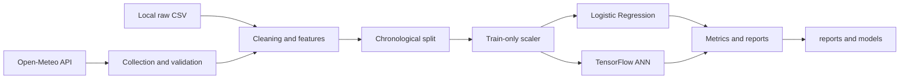

# Weather Classification: Logistic Regression vs ANN

An end-to-end machine learning project that classifies observed weather conditions for nine Moroccan cities using Open-Meteo hourly observations. It compares a class-balanced Logistic Regression baseline with a lightweight TensorFlow/Keras feed-forward neural network.

This classifies the condition represented by each observation. It is **not a forecasting system**: no future target shift is applied.

## Objectives

- Build a reproducible, leakage-safe classification workflow.
- Compare an interpretable linear baseline with a small ANN.
- Demonstrate API integration, validation, preprocessing, evaluation, persistence, testing, and reporting.

## Features and target

Both models use `temperature`, `humidity`, `wind_speed`, `surface_pressure`, `cloud_cover`, `hour`, and `month`.

| Class | Meaning | WMO codes |
|---|---|---|
| `0` | Clear | 0, 1 |
| `1` | Cloudy/Fog | 2, 3, 45, 48 |
| `2` | Precipitation/Storm | 51, 53, 55, 56, 57, 61, 63, 65, 66, 67, 71, 73, 75, 77, 80, 81, 82, 85, 86, 95, 96, 99 |

Unsupported or missing codes raise an error instead of being silently mislabeled. Open-Meteo is requested with `past_days=30`, `forecast_days=1`, and UTC timestamps. Exact coverage depends on when collection runs and is recorded in the raw timestamps.

The nine configurable cities are Marrakech, Casablanca, Rabat, Fes, Agadir, Tangier, Oujda, Meknes, and Laayoune.

## Architecture



## Repository layout

```text
src/weather_classification/
  config.py            # Cities, features, paths, and settings
  data_collection.py   # Open-Meteo client and response checks
  preprocessing.py     # Cleaning, labels, features, split, scaling
  models.py            # Logistic Regression and ANN training
  evaluation.py        # Metrics and report serialization
  visualization.py     # EDA and model figures
  main.py              # Command-line workflow
tests/                 # Offline unit tests with synthetic data
data/raw/              # Generated observations (ignored by Git)
data/processed/        # Generated datasets (ignored by Git)
models/                # Generated model artifacts (ignored by Git)
reports/               # Generated metrics and figures
```

## Installation

Python 3.10-3.13 is supported by the project metadata. TensorFlow availability varies by platform; use a supported TensorFlow release for your interpreter.

```bash
python -m venv .venv
# Windows PowerShell
.venv\Scripts\Activate.ps1
python -m pip install --upgrade pip
pip install -r requirements.txt
pip install -e .
```

## Run

From the repository root:

```bash
python -m weather_classification.main
```

Use a local raw CSV instead of the API:

```bash
python -m weather_classification.main --input data/raw/weather_raw.csv
```

Run only Logistic Regression, useful when TensorFlow is unavailable:

```bash
python -m weather_classification.main --input path/to/raw.csv --no-ann
```

The workflow uses a chronological holdout, fits the scaler only on training data, and uses class-balanced weights. The ANN uses early stopping when its internal validation split is available.

## Outputs

- `data/raw/weather_raw.csv`: observations returned by Open-Meteo.
- `data/processed/weather_model_dataset.csv`: cleaned observations with target/features.
- `models/logistic_bundle.pkl`: model, scaler, and feature names.
- `models/ann.keras`: Keras model when ANN training is enabled.
- `reports/metrics.json`: accuracy, per-class metrics, macro F1, balanced accuracy, and matrices.
- `reports/model_comparison.csv`: compact model comparison.
- `reports/class_distribution.json`: class counts by data partition and an evaluation limitation note.
- `reports/figures/`: EDA, confusion matrices, and ANN curves.

Generated outputs are ignored by Git and recreated by the run command. No performance values are claimed here; run the workflow to obtain results for the collected time window.

## Tests

Tests do not call Open-Meteo or require TensorFlow:

```bash
pytest
```

They cover label mapping, invalid data, chronological splitting, train-only scaling, API response validation, dataset validation, and evaluation metrics.

## Limitations and future work

- This is classification of observed conditions, not future prediction.
- A longer versioned historical dataset would make comparisons more stable than a rolling 30-day collection.
- City-aware or blocked time-series cross-validation could provide stronger uncertainty estimates.
- Forecasting would require shifting the target into the future and redesigning the feature/label protocol.

## License

MIT. See [LICENSE](LICENSE).
